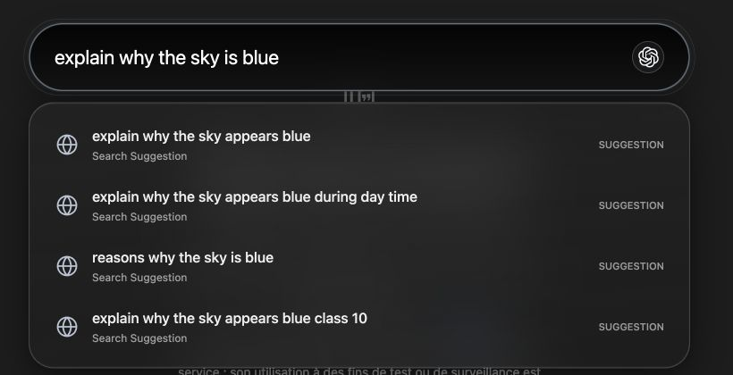
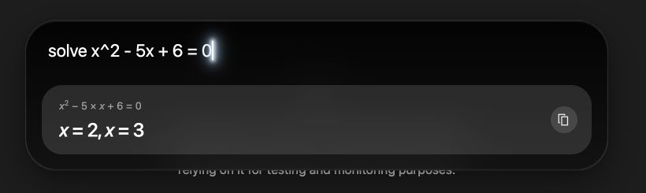
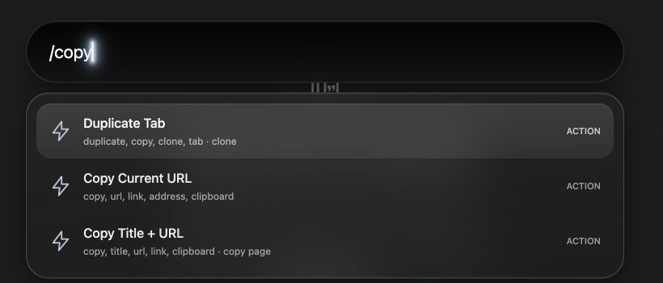

# Command Bar + Live Wallpaper

A keyboard-first command bar for tabs, links, web search, ChatGPT, calculations, definitions, and browser actions—paired with a new-tab page for your own live wallpapers and widgets.

[Download the latest release](https://github.com/manavo-o/Command-Bar-Live-Wallpaper/releases/latest) · [Install ChatGPT Search](https://chromewebstore.google.com/detail/chatgpt-search/ejcfepkfckglbgocfkanmcdngdijcgld) · [Installation](#installation) · [Keyboard shortcuts](#keyboard-shortcuts)



## Before you install

- **Use a browser that supports Manifest V2 extensions.** The extension has been manually tested in Helium.
- **Install OpenAI’s [ChatGPT search extension](https://chromewebstore.google.com/detail/chatgpt-search/ejcfepkfckglbgocfkanmcdngdijcgld) and set ChatGPT as your browser’s default search engine to use the ChatGPT integration.** Keep the search extension enabled. The command bar forwards AI queries to your browser’s default search engine; the ChatGPT icon alone does not configure that destination.
- The other features—tab search, direct links, Google search, math, dictionary lookups, wallpapers, and widgets—work independently of the ChatGPT Search setup.

## What the command bar does

Open it with **⌘K on macOS** or **Ctrl+K on Windows/Linux**, or click the extension’s toolbar button. Change the shortcut in the browser’s extension-shortcut settings if another application or browser command uses it.

### Search tabs, history, and bookmarks

Type part of a page title or address to find an open tab, a saved bookmark, or a page from your history. Results combine matching destinations, show their sources, and switch to an existing matching tab when one is available.

- Search the current window, or enable **Search across all windows by default** in settings.
- Use `@history example` or `@bookmarks example` to search a specific source.
- Use `/allwindows example` to include tabs from every window.
- Inline autocomplete completes matching addresses. Accept it with Right Arrow or Tab; Backspace cancels the selected completion.
- Remote search suggestions and inline autocomplete can each be turned off.

### Open links directly

Type `gmail.com`, `www.wikipedia.org`, or a full URL such as `https://example.com/docs`, then press **Enter** to open it. Bare domains use HTTPS. Paths, query strings, and fragments are preserved. Localhost addresses and valid IPv4 addresses are also recognized.

Use **Shift+Enter** when you want to search Google for the text instead of opening the address.

### Ask ChatGPT from the input

Questions and writing or research prompts activate the inline ChatGPT button. A soft ripple around the typing box indicates AI mode; the separate AI action row is replaced by the button. Press Enter or click the button to open the query through your browser’s default search engine. Answers open in the destination tab.

**The ChatGPT search extension and ChatGPT-as-default setup above are required for these queries to reach ChatGPT.** No API key is entered in this extension.

Choose a routing mode in **Settings → Command Bar → Search & AI**:

| Mode | Plain Enter behavior |
| --- | --- |
| Balanced | Questions and tasks use the browser default; ordinary web searches use Google. |
| Prefer AI | Ordinary searches use the browser default too. |

Direct URLs, math, dictionary commands, and explicit scopes retain their own behavior. **Shift+Enter always searches Google.**

### Calculate without leaving the page



Enter an expression to see a local answer, with formatted fractions, powers, roots, and equations. Press **Enter** or use the copy button to copy the result.

| Try | What it does |
| --- | --- |
| `(24 * 18) / 3` | Arithmetic with grouping |
| `sqrt(144) + 2^3` | Roots, powers, and functions |
| `mean([12, 18, 24])` | List statistics; median, variance, and standard deviation are also supported |
| `solve x^2 - 5x + 6 = 0` | Solve a supported quadratic equation |

Calculations run locally. Unsupported symbolic expressions can appear as formatted previews; they are not a general-purpose computer algebra system.

### Look up words and synonyms


Use `serendipity def`, `define serendipity`, or `calm syn`. Definition cards include pronunciation and parts of speech when available, with a disclosure for more detail. Word lookups also check spelling and show when a correction was made.

Press **Enter** to copy a successful definition or synonym list. Missing words can open Apple Dictionary on macOS. Definitions, spelling checks, and synonyms require an internet connection.

### Run browser actions



Start with `/` to browse actions, or type a filter such as `/copy`. Available actions include:

- Create, reload, duplicate, close, and reopen tabs.
- Pin or mute a tab, move it into a new window, or discard background tabs.
- Open history, downloads, or the bookmark manager.
- Copy the current URL or the page title and URL; go back or forward.

Enable or disable individual palette actions in settings. You can also add custom search-engine URL templates, such as `https://www.youtube.com/results?search_query={query}`, and assign Ctrl+Enter, Alt+Enter, or Meta+Enter shortcuts. Shift+Enter stays reserved for Google.

### Glass styling and caret glow

The command bar uses translucent glass surfaces and a brighter blinking caret glow in every mode. AI mode adds the animated border ripple. Comfortable and compact density options control spacing. Reduced-motion and high-contrast preferences have fallbacks for the decorative effects.

*Screenshots show the real extension on example.com, cropped to the command bar. They contain generic demo queries, with no personal details, browsing history, browser chrome, or mouse pointer.*

## Live wallpapers and the new-tab dashboard

Use your own images, GIFs, MP4s, and WebM videos as new-tab backgrounds. Media stays in the browser’s local wallpaper library.

| Feature | Options |
| --- | --- |
| Wallpaper library | Upload media, preview it, and choose an active wallpaper. |
| Rotation | Keep one wallpaper, cycle the library in order, or shuffle it on a timer. |
| Day & night | Pick separate wallpapers and switch at manual hours or sunrise/sunset using the configured weather location. |
| Motion | Ken Burns pan/zoom for still images, mouse parallax, and adjustable crossfade duration. |
| Appearance | Video playback speed, brightness, and contrast. |
| Clock & date | Toggle each display and choose a 12- or 24-hour clock. |
| Weather | Automatic or manually chosen location, with Fahrenheit or Celsius. |
| Quotes | An offline quote that changes with each new tab. |
| Focus timer | Configurable work and break durations. |
| Dashboard placement | Move the dashboard with the mouse or keyboard. |

Open the extension’s settings to configure the wallpaper library, effects, rotation, widgets, command bar, and backup options. Export or import a JSON profile for preferences and action settings; uploaded wallpaper files are not included in that profile.

## Installation

1. Install the required [ChatGPT search extension](https://chromewebstore.google.com/detail/chatgpt-search/ejcfepkfckglbgocfkanmcdngdijcgld) if you want ChatGPT integration, and confirm ChatGPT is the browser’s default search engine.
2. Download **`command-bar-live-wallpaper-v1.6.0.zip`** from the [latest release](https://github.com/manavo-o/Command-Bar-Live-Wallpaper/releases/latest). Choose the named extension asset, which contains the ready-to-load files.
3. Extract the ZIP. Open your browser’s extensions page and enable **Developer mode**.
4. Choose **Load unpacked** and select the extracted folder containing `manifest.json`.
5. Open a new tab for the dashboard. On a normal website, open the command bar with its shortcut or toolbar button.

The download includes the production JavaScript bundle. **Node.js and npm are not needed to use the extension.** A SHA-256 checksum is included with the release.

To update an existing unpacked installation, replace the files in its existing folder, reload the extension, and refresh open pages. Keep the installed extension and browser profile to retain its locally stored settings and media.

If AI queries still open another search engine, check that ChatGPT Search is enabled and ChatGPT is the browser default. If the overlay will not open, try the toolbar button, check the configured shortcut, and refresh the page. Browser-internal and other protected pages can restrict extension injection.

## Keyboard shortcuts

| Key | Action |
| --- | --- |
| ⌘K / Ctrl+K | Toggle the command bar; configurable in extension shortcuts |
| Enter | Open a URL, submit a search, execute the selected result, or copy a math/dictionary answer |
| Shift+Enter | Search Google |
| ↑ / ↓ or Ctrl+K / Ctrl+J | Move through results while the input is focused |
| Tab / Shift+Tab | Navigate results; Tab accepts a selected inline completion first |
| Right Arrow | Accept a selected inline completion |
| Backspace | Cancel a selected inline completion |
| Escape | Close the command bar |
| Configured Ctrl/Alt/Meta+Enter | Search a custom engine |

## Storage and network use

Wallpapers, preferences, and cached icons are stored locally. Tabs, bookmarks, and browsing history provide command-bar results.

| Feature | External service or destination |
| --- | --- |
| Enabled search suggestions | Google receives the typed query. |
| Google searches | Google receives the submitted search. |
| AI queries | Your configured browser-default search engine receives the submitted query. |
| Definitions | FreeDictionaryAPI |
| Spelling and synonyms | Datamuse |
| Weather and city lookup | Open-Meteo |
| Website icons | Browser caches, icon links from open tabs, and direct favicon files |

All-sites access supports the overlay and icon discovery; unlimited storage supports large wallpaper files. Configure suggestions, widgets, and routing in settings to choose which features you use.

## Development

Source lives in [`Command Bar + Live Wallpaper/`](Command%20Bar%20%2B%20Live%20Wallpaper/). From the repository root:

```sh
cd "Command Bar + Live Wallpaper"
npm ci
npm run build
npm test
npm run check
```

The search and background logic use JavaScript; React handles the command-bar view. `npm run build` rebuilds its checked-in production bundle, and `npm run watch` rebuilds while editing. Reload the extension and refresh the affected pages after changes.

The v1.6.0 release passed 127 automated tests and syntax checks. See [performance and verification notes](Command%20Bar%20%2B%20Live%20Wallpaper/docs/performance-verification.md) for live checks, accessibility fallbacks, and remaining manual-test limits.
